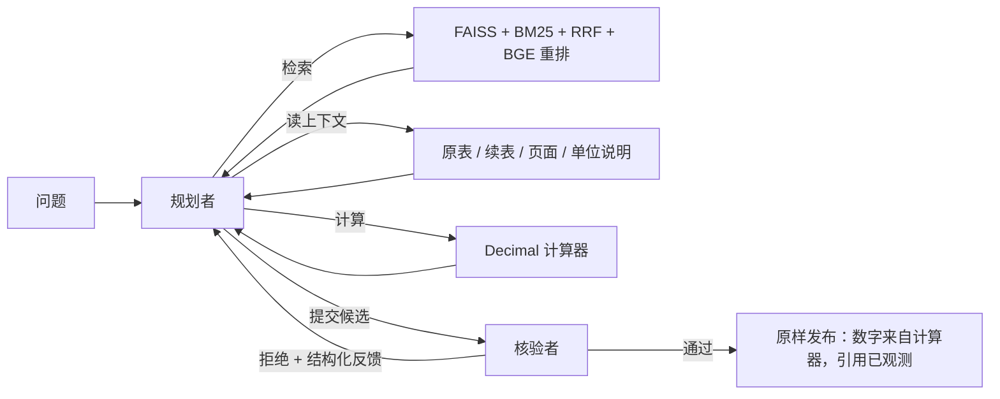

# fin-mhqa：财报多跳问答 Agent

这是一个面向上市公司财报的**多跳证据问答 Agent**，以及一套**量化 Agent 技术收益的评测体系**。

- **问答**：在 10 家公司的 2025 年半年报（1,750 页）上，Agent 通过混合检索、受控上下文读取和确定性计算，回答跨公司、跨报表的多跳问题。每个答案都附带可以回溯到原文的引用。
- **评测**：每条运行轨迹都可以审计重放。每项技术的作用都用冻结的评测集和配对置信区间来量化。

## 结论速览

| 问题 | 答案（Dev，95% 区间） |
| --- | --- |
| 检索有没有用？ | 有。闭卷 18.7% → 固定 RAG 61.3%，**+42.7 [+28.0, +56.7]** |
| Agent 循环有没有用？ | 有。固定 RAG → 单模型 Agent 92.7%，**+31.3 [+18.7, +44.7]** |
| 格式修复有没有用？ | 有。单模型 Agent 92.7% → 98.7%，**+6.0 [+2.7, +10.0]** |
| 多角色（规划 + 核验）有没有用？ | 证据干净时没有：+0.7 [−5.3, +6.7]，而且成本更高 |
| 证据出错时呢？ | 原版核验角色没有净收益。按故障诊断改进核验角色后，在列错位故障下比单模型高 **+20.5 [+4.5, +36.4]**（初步结果，待 Test 确认） |

完整结论、分档可信度和局限见 **[项目报告](docs/REPORT.md)**。

## 架构



- **Agent 编排**：用 LangGraph 实现，全程有预算控制与预留，并支持结构化重规划。
- **模型调用**：模型输出经过 JSON schema 校验，不合格时带着错误反馈修复一次。
- **证据核验**：发布前会检查引用是否确实观测过、数字是否确实来自计算器。
- **审计**：每一步的模型调用、工具调用和计算都可以重放核对。

## 快速上手

```bash
uv venv --python 3.11
uv pip install --python .venv/bin/python -r requirements-m1.lock.txt -r requirements-agent.lock.txt -r requirements-service.lock.txt
uv pip install --python .venv/bin/python --no-deps -e .
.venv/bin/python -m pytest -q
```

**看一道题的完整过程**：这一步不需要模型、检索服务或 API key。下面这个例子里，列错位故障把「本期」和「上期」对调了，核验角色用会计勾稽关系识破了它。

```bash
PYTHONPATH=src .venv/bin/python scripts/demo.py --replay docs/examples/f2_column_swap_caught
```

**实时问一道新题**：需要先按[复现指南](docs/system/REPRODUCE.md)建好索引并启动检索服务，再在 git 忽略的 `.env` 中配置 `LLM_BASE_URL`、`LLM_MODEL_NAME` 和 `LLM_API_KEY`。

```bash
PYTHONPATH=src .venv/bin/python scripts/demo.py --question "贵州茅台2025年上半年合并口径营业收入是多少？金额以亿元表示，四舍五入保留两位小数。"
```

## 作为服务运行（多用户 + SSE）

```bash
PYTHONPATH=src .venv/bin/python scripts/service_admin.py --name alice          # 生成 API key，只显示一次
PYTHONPATH=src .venv/bin/python scripts/serve.py --agent "cassette:docs/examples/*" --speed 0.2   # 重放录制轨迹，不调用模型
# 或者运行真实 Agent：--agent graph:configs/bench_b3_graph_repair_v2_planner_v2_ctx.json
```

然后打开 http://127.0.0.1:8200/ ，输入 API key 后提问，规划、检索、核验和答案会通过 SSE 实时显示。接口、协议、多用户设计和压测结果见 [Agent 服务](docs/system/SERVICE.md)。

## 目录

| 路径 | 内容 |
| --- | --- |
| `src/finmhqa/ingest`、`retrieval` | PDF 解析与切块、混合检索服务 |
| `src/finmhqa/agent` | 四角色图、工具、上下文读取器、模型接口、基线 |
| `src/finmhqa/bench` | 事实台账、题目生成、质检、Test 保护、评分、故障注入 |
| `src/finmhqa/service` | 多用户 API、SSE、调度器、限流、持久化、前端 |
| `src/finmhqa/harness` | 错误分类、额度止损、逐题续跑、录制—重放、来源记录、检索锁 |
| `configs/` | 冻结的实验配置（`bench_*.json`）与 Test 登记表 |
| `scripts/` | 运行、审计、评分、报告、演示 |
| `docs/` | [文档索引](docs/README.md)：报告、实验、评测集、系统、归档 |
| `docs/evidence/` | 各实验的报告、审计与日志（JSON） |
| `data/`、`index/` | 原始 PDF、语料、索引、运行结果（体积大，不纳入 git） |

## 状态

- **已完成**：语料、检索、Agent、冻结的评测集、基线、格式修复、故障注入、核验角色 v2、运行 harness（额度用完即停、逐题续跑、录制—重放回归、金丝雀、运行登记表、CI），见[运行 harness](docs/system/HARNESS.md)；多用户服务（SSE、公平调度、限流、取消），见[Agent 服务](docs/system/SERVICE.md)。
- **进行中**：规划者 v2 的无故障 Dev 运行因 API 额度用完，等待补跑。
- **下一步**：登记最终配置，在 Test 上做一次无偏验证。

所有阶段、失败记录和数值来源见[实施进度](docs/IMPLEMENTATION_STATUS.md)。项目已于 2026-09-23 调整范围，不再做 SFT/RL 训练，原因见[范围调整](docs/PROJECT_GAP_AND_ACCEPTANCE.md)。
