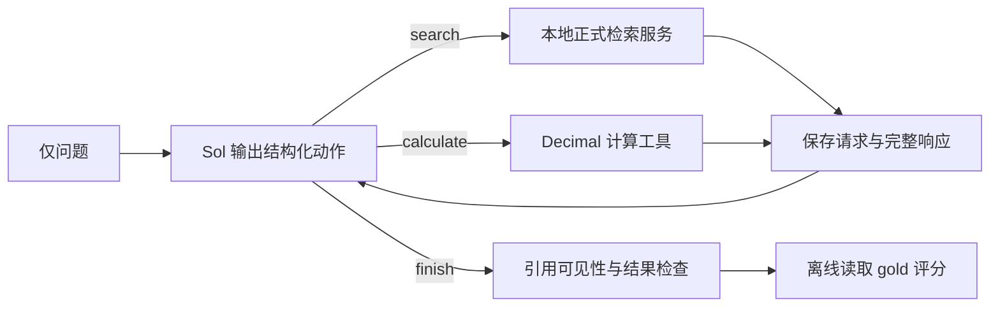

# 多指标桥接开发集与内置教师受控运行

本阶段补齐30条收入QA小样的两项缺口：新增指标和条件桥接，以及真实工具交互轨迹。它是M3前置集成试验，不等于完整LangGraph四角色验收、独立测试集或学生训练。

## 题目与证据

新增12题：8条条件实体选择桥接、2条比较、2条聚合，覆盖10家公司及营业收入、归母净利润、经营活动现金流净额。桥接先比较两家公司收入选择一个实体，再查询该实体的另一指标；gold目标chunk不同于两条选择证据。它们不是供应链关系桥接，题目也不保证实际检索只会返回gold选定的chunk：一次检索若顺带返回了目标事实，仍应据实记录，不能伪称模型必须执行三次查询。

`freeze_bridge_pilot.py`验证来源、期间、单位、精确quote、源页数值和Decimal结果，再输出只有id/question的文件。gold与题目在`802338e`中先于作答冻结。生成者实际指定为内置`gpt-5.6-sol`；求解是新的Codex会话，不继承生成任务历史。所有题仍是开发题，沿用部分旧检索开发证据，不进入Test。

初版q009海尔利润表续页缺单位/期间表头，已改绑p6完整主要数据表，并统一归母指标表述；数值答案不变，初版保留。生成代理原视觉审核记录过强，原记录留存为`source_review.generator_claims.json`并由主代理的新核验记录替代：11个新增源页完整查看，另外10页通过渲染哈希确认与此前已完整查看的页面一致。实际gold共21个物理页。该核验不声称独立人工或独立Judge。

## 控制流



内置教师通过桌面应用自带Codex CLI 0.153.4的ChatGPT登录运行，不提取登录凭证，不使用外部教师API。旧PATH下npm包装器缺二进制，故使用应用内可执行文件；未修改全局安装或用户配置。

每次决策在空目录、新的ephemeral会话中执行，忽略用户配置，关闭shell、apps、多代理、浏览器、计算机与hooks，关闭web search；输入只包含问题和本题此前真实动作/观测。仍可能收到Codex运行提示。审计会拒绝发现的任何非允许原生工具事件；这属于受控接口加事件核验，不是声称整个用户文件系统对进程物理不可读。

教师自主生成query、选择dense/bm25/hybrid与公司过滤，最多6次search、10次决策。检索沿用正式9,322条数据、top5/n_cand30及父表附加，未修改索引或重排模型。两个教师任务并发，检索请求在客户端串行化；每题历史独立，完整返回持久化。计算只支持Decimal转换、求和、差额，禁止任意代码表达式。

计算参数错误返回结构化可恢复观测；教师可调整后重试。超出预算、未见引用、原生工具越界或教师未完成等失败保留，离线评分不删除这些题。正式批次中不根据答案修改提示词、标签或阈值。

## 轨迹与评测边界

`trajectory.jsonl`依次保存question、teacher_decision、tool_request、tool_response、final/error。每步还有真实Codex事件、输入、决策和usage；审计将轨迹决策逐项与Codex输出交叉比对。决策中的reason是可见简要依据，不称模型内部完整思维链。

离线评分检查数值、答案单位，桥接另检查选中公司；分跳及引用的金额/指标锚点匹配仅为诊断，不等同语义Faithfulness。顺序指标检查目标公司新指标查询是否发生在两家选择查询响应之后，不声称证明内部因果推理。独立Judge、多个随机运行的稳定性、架构消融另行实施。

当前是外部动作循环，每步将可见历史作为JSON传给新的CLI决策会话。完整输入输出真实可追溯，但不是单一原生多轮模型会话；不能直接冒充LangGraph四角色轨迹或满足GRPO append-only token/logprob契约。后续需适配学生模板并验证训练前缀，才作为正式训练样本使用。

## 复现

需保留本地财报、正式索引、已批准模型和有效Codex登录。下列输出目录必须不存在，避免覆盖旧证据。

```bash
.venv-retrieval/bin/python -m uvicorn finmhqa.retrieval.server:create_app \
  --factory --host 127.0.0.1 --port 8100
# 另一个终端，服务就绪后：
.venv/bin/python scripts/run_bridge_teacher.py \
  --questions docs/evidence/bridge_pilot_v1/questions.jsonl \
  --out data/agent_bridge_v1/recheck --workers 2
.venv/bin/python scripts/evaluate_bridge_teacher.py \
  --gold docs/evidence/bridge_pilot_v1/gold.jsonl \
  --freeze docs/evidence/bridge_pilot_v1/freeze.json \
  --run data/agent_bridge_v1/recheck --out data/agent_bridge_v1/recheck.evaluation.json
.venv/bin/python scripts/audit_teacher_trajectory.py \
  --run data/agent_bridge_v1/recheck --out data/agent_bridge_v1/recheck.audit.json
```

复跑会使用Codex额度；当前脚本不是无人值守批量合成服务。后续学生型号、训练与算力预算仍需用户决策。
