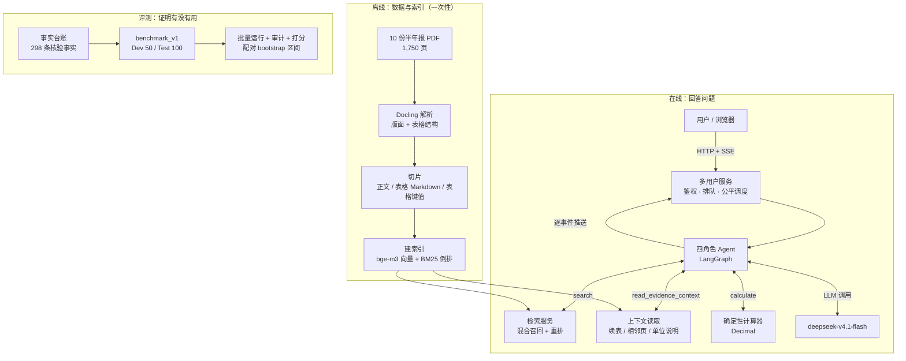
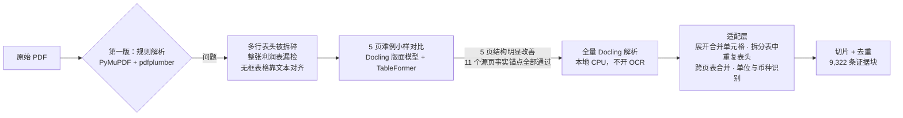
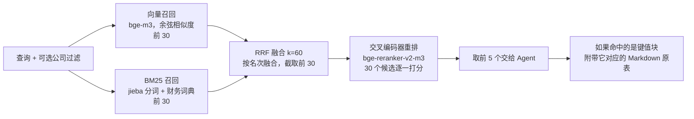
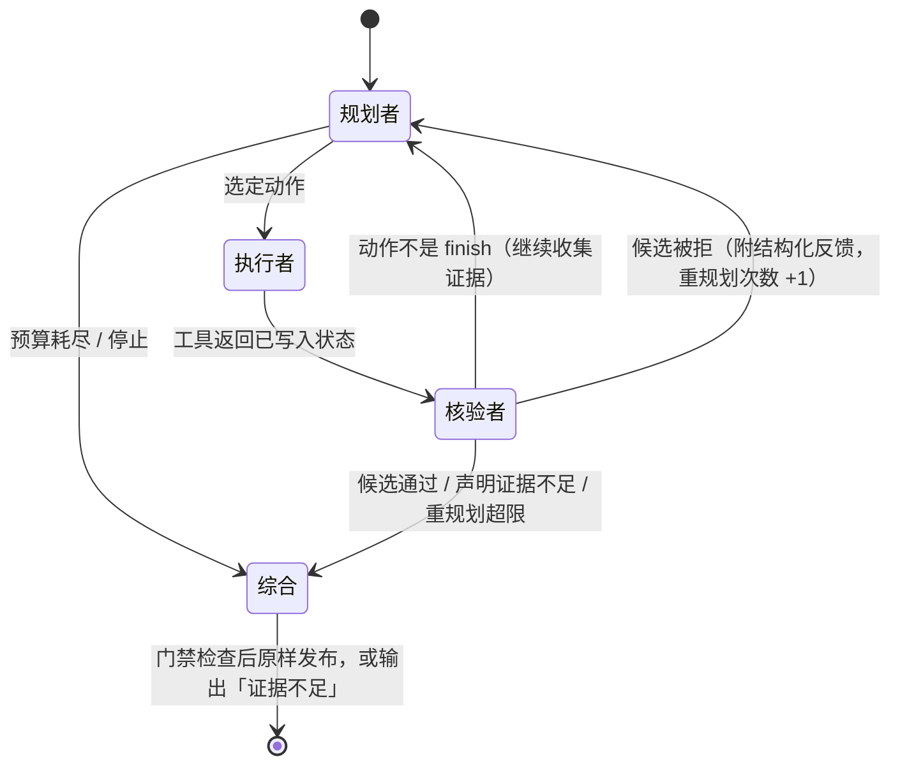
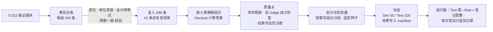
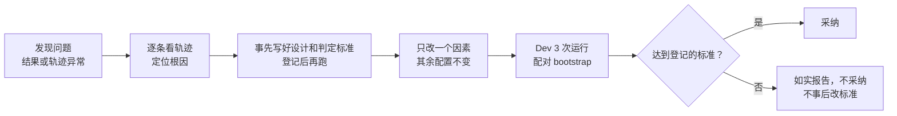
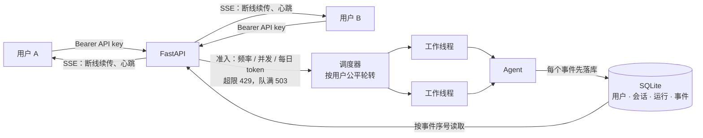

# 项目设计说明（面试问答版）

> 财报多跳问答 Agent（fin-mhqa）。本页按面试常见问题组织，讲清每个设计「做了什么、为什么这么做、效果如何」，不展开代码细节。数字均来自仓库内的实验记录，每节末尾给出详细文档的链接。
>
> 更新：2026-10-16。Test 验证正在运行，结果出来后补到第 8 节。

**目录**

1. [一句话介绍与整体架构](#1-一句话介绍与整体架构)
2. [端到端流程：一个问题从输入到答案](#2-端到端流程一个问题从输入到答案)
3. [数据：解析与切片](#3-数据解析与切片)
4. [检索：召回、融合与重排](#4-检索召回融合与重排)
5. [Agent 编排](#5-agent-编排)
6. [评测体系：每个评测集里有什么](#6-评测体系每个评测集里有什么)
7. [改进历程：发现问题 → 定位 → 修复 → 验证](#7-改进历程发现问题--定位--修复--验证)
8. [结果解读](#8-结果解读)
9. [工程化：服务、多用户与 Harness](#9-工程化服务多用户与-harness)
10. [局限与下一步](#10-局限与下一步)
11. [高频追问速答](#11-高频追问速答)

---

## 1. 一句话介绍与整体架构

### Q：用一句话介绍这个项目？

基于 10 家 A 股公司 2025 年半年报，做了一个能回答**多跳财务问题**的 Agent。例如：「比较比亚迪与宁德时代的营收，选出较高的一家，再算它的研发费用」。项目的重点是**用可信的评测证明每一项技术到底有没有用**，而不是堆功能。

### Q：为什么选这个场景？难点在哪？

财报问答看起来简单，实际有很多容易答错的地方：

- **口径**：合并报表和母公司报表的数字不同；「净利润」和「归属于母公司股东的净利润」也不是一回事。
- **期间**：同一张表里，「本期」和「上年同期」两列挨在一起；资产负债表则是「期末」和「期初」。
- **单位**：有的表写「元」，有的写「千元」，有的表头根本不写，要到报告开头的总说明里找。
- **表格**：一张报表经常跨好几页，续表没有标题，PDF 解析容易把表头拆碎。
- **多跳**：需要先查 A、根据 A 的结果决定查 B，再做计算。单次检索的 RAG 做不到。

### Q：整体架构是什么？



---

## 2. 端到端流程：一个问题从输入到答案

### Q：用户输入一个问题后，系统具体做了什么？

以一道**条件桥接题**为例：「比较比亚迪与宁德时代 2025 年上半年合并口径营业收入，选较高的一家，再查该公司研发费用（亿元，保留两位小数）」。

```mermaid
flowchart TD
    A[用户在网页输入问题] --> B["POST /sessions/{id}/questions<br/>校验 API key、长度、频率与配额"]
    B -->|超限| B1[429 / 503 + Retry-After]
    B -->|通过| C[写入 SQLite：run 状态 = queued<br/>立即返回 202 和 run_id]
    C --> D[浏览器打开 SSE 事件流<br/>GET /runs/{id}/events]
    C --> E[调度器：按用户轮转取任务<br/>交给空闲工作线程]
    E --> F[Agent 开始运行]

    subgraph AGENT["Agent 内部循环（每一步都作为事件推给浏览器）"]
        F --> P1[规划者：拆成子问题<br/>q1 比亚迪营收 / q2 宁德营收 / q3 比较 / q4 研发费用]
        P1 --> X1[执行：search ×2<br/>两家公司的利润表]
        X1 --> P2[规划者：读到两家营收<br/>发现宁德表头单位未标注]
        P2 --> X2[执行：read_evidence_context<br/>读取单位说明 → 千元]
        X2 --> P3[规划者：比较后选定公司<br/>再 search 研发费用]
        P3 --> X3[执行：calculate<br/>千元 → 亿元，四舍五入两位]
        X3 --> P4[规划者：finish，提交候选答案<br/>附引用的证据块 ID]
        P4 --> V{核验者：口径？期间？单位？<br/>来源优先级？选对公司？}
        V -->|不通过：结构化问题清单| P2b[规划者按反馈补查或修正]
        P2b --> V
        V -->|通过| G[确定性门禁：数字必须来自计算器<br/>引用必须是看到过的证据]
        G --> H[原样发布答案]
    end

    H --> I[写入最终事件与 token 用量<br/>run 状态 = completed]
    I --> J[浏览器收到 final / end 事件<br/>显示答案、步骤时间线、证据高亮]
```

**每一步的作用**：

1. **入口**：服务层先鉴权（API key 只存哈希），再检查用户的提问频率、未完成任务数和每日 token 配额，超限直接返回 429。请求不会阻塞等待：服务立即返回 `run_id`，浏览器随后用 SSE 订阅进度。
2. **调度**：多个用户同时提问时，按用户轮转取任务，一个用户的突发请求占不满所有工作线程。
3. **规划**：规划者维护一个最多 6 项的子问题计划，每一步只选一个动作：检索、读取上下文、计算或提交。
4. **执行**：工具调用全部经过检查，包括预算是否够用、上下文读取的锚点是否是已经看到过的证据等。工具的原始返回逐条写进轨迹。
5. **核验**：核验者只看问题、计划、真实工具返回和候选答案，按口径、期间、单位、来源优先级逐项审核。不通过时给出结构化的问题清单，例如「PERIOD_MISMATCH：这个数字所在列的表头是上年同期」，规划者据此重新规划。
6. **发布**：两道确定性门禁之后，**原样发布**核验通过的候选答案，不再让模型润色，避免润色时改动数字：
   - 答案数字必须等于某次计算器的输出；
   - 每个引用都必须是本题真实看到过的证据。
7. **推送**：所有事件先写入数据库，再推给浏览器，所以断线重连时可以从断点续传，不丢不重。

**预算**：每题最多调用模型 12 次、工具 8 次、检索 6 次、重规划 2 次。预算快用完时，系统会给最后一次核验和最后一次计算预留位置，见第 5 节。

---

## 3. 数据：解析与切片

### Q：数据从哪来？规模多大？

- **来源**：巨潮资讯网上 10 家 A 股公司的 2025 年半年报原文 PDF，共 1,750 页。
- **行业**：家电（美的、格力、海尔）、新能源（比亚迪、宁德时代、亿纬锂能）、白酒（茅台、五粮液、泸州老窖）、乳制品（伊利）。同行可以横向比较，也能出跨行业的题。
- **可追溯**：每份 PDF 都记录了 SHA256 和下载时间，后续每条证据都能追溯到源文件和物理页码。

### Q：PDF 怎么解析？为什么换解析器？



- **第一版用规则解析**，遇到复杂表格问题很多：多行表头被拆碎，有一整张利润表漏检，无框表格只能靠文本对齐来猜。
- **换解析器前先做受控对比**：只挑 5 页最难的样本做小样，逐行对照原页面。确认有明确改善后，才扩展到全量。旧的解析结果（8,452 条）完整保留，没有被覆盖。
- **全量结果**：1,750 页转换零失败，得到 9,322 条证据块，其中正文 3,719 条、表格 Markdown 2,823 条、表格键值 2,780 条。
- **不猜数据**：有 32 张表的单元格跨度互相重叠，没有算作成功的结构表，只保留原页正文。表头识别不出来的列，统一标注「列名未识别」，不猜列名。

### Q：怎么切片？

每份报告按章节树遍历，产出三种块：

| 类型 | 怎么切 | 为什么 |
| --- | --- | --- |
| 正文 `text` | 按章节累积段落，到约 350 个 token 时切分，单块上限 450 个 token。前一块末尾的短段落会带入下一块，保证语义连续 | 尺寸适合向量模型（bge-m3，最长 1,024 token） |
| 表格 Markdown `table_md` | 每片最多 20 行 × 12 列，**每片都重复表头** | 保留行列关系，大模型擅长读 Markdown 表格 |
| 表格键值 `table_kv` | 同一片表格改写成「行名：列名 数值，列名 数值」 | 让「营业收入 本期 xxx」这种行列组合可以被直接检索到，BM25 尤其受益 |

**每个块都带一行前缀**：「【公司 \| 2025年半年度报告 \| 章节路径】」，表格再加「表：标题　单位：…　币种：…」。这样即使块被单独取出，也知道它属于哪家公司、哪一节、什么单位。

**块的元数据**：公司、股票代码、源文件哈希、物理页码范围、章节路径、父表 ID 和分片序号（用来找续表）、单位来源、质量标记。

**去重**：正文用 SimHash 做近似去重。表格只做精确去重，因为两张数字略有不同的表不能被模糊去重合并。

### Q：切片有没有踩过坑？

- **续表问题**：表格中途又出现「期末 / 期初」表头时，如果不处理，下面的金额会被吞进表头。修复方法是在表内遇到新表头就拆成新的区段。
- **合计行召回不到**：长报表最后一个续表块里的「资产总计」，单独来看缺少上下文，检索召回不到。Agent 现在靠上下文读取工具绕过去（见第 4、5 节），切片层面还没有修。

详见：[语料结果](system/DOCLING_CORPUS_RESULTS.md)、[解析器小样](archive/DOCLING_PILOT_RESULTS.md)。

---

## 4. 检索：召回、融合与重排

### Q：检索流程是怎样的？



- **为什么两路召回**：向量召回擅长语义相近的问法，比如「赚了多少钱」能对上「净利润」；BM25 擅长精确的术语和数字，比如「经营活动产生的现金流量净额」。两路互补。
- **为什么用 RRF**：两路的分数量纲不同，无法直接相加。RRF 只看名次，简单、稳健，不需要调权重。
- **为什么要重排**：召回阶段的向量是双塔模型分别编码查询和文档；交叉编码器把查询和文档放在一起打分，更准，但也更慢，所以只对 30 个候选做。
- **公司过滤**：Agent 检索时可以指定公司，避免把别家公司的同名指标召回来。
- **附带父表**：键值块适合被检索命中，但大模型读 Markdown 表格更可靠，所以命中键值块时一并附上原表。
- **部署方式**：全部模型在本地 CPU 推理，检索服务是单独的 HTTP 进程，只有一个推理槽，所有调用方都要排队。

### Q：检索效果怎么评估？

用两组标签（都在实验前就固定好），按流水线的每个阶段分别计算指标：

| 指标 | 含义 |
| --- | --- |
| Hit@K | 前 K 名里至少有一个相关块，表示「能不能答」，是主指标 |
| Recall@K | 相关块被召回的比例。同一个数值常出现在好几个块里，所以这个值天然偏低 |
| MRR@10 | 第一个相关块排得多靠前 |
| nDCG@10 | 综合考虑名次和相关块数 |

**结果**（线上流水线 = RRF + 重排）：

| 评测集 | Hit@1 | Hit@5 | MRR@10 | nDCG@10 |
| --- | --- | --- | --- | --- |
| 30 题检索开发集 | .70 | **.967** | .81 | .71 |
| Dev 68 条事实 | .69 | **.91** | .78 | .60 |

各阶段的对比（30 题集，Hit@5）：向量 .80，BM25 .50，RRF .83，**RRF + 重排 .967**。

- **重排是显著有效的**：事实级 Hit@5 提高 7.4 个百分点 [1.5, 14.7]，30 题集上提高 13.3 个百分点 [3.3, 26.7]，区间都不跨 0。
- **多跳会放大误差**：每一跳单独看，前 5 名命中率是 91%；要求一道题的所有跳都命中，只剩 84%。

### Q：检索有没有发现问题？

| 问题 | 现象 | 状态 |
| --- | --- | --- |
| 合计行召回不到 | 3 条「资产总计」事实在任何阶段的前 30 名里都没出现 | Agent 用上下文读取绕过；切片层未修 |
| RRF 分票 | 同一个数值的表格块和键值块分别被两路召回，各自只拿到单路分数，在截断到 30 名时一起被丢掉 | 已定位，未修。修复会改变 Agent 行为，需要单独登记实验 |
| BM25 单路较弱 | 30 题集上 Hit@5 只有 .50 | 在融合中仍有正贡献 |

### Q：早期检索验收为什么一开始没过？

第一版标签只认「出题时选定的那一个块」。但同一个数字在汇总表、报表、键值块里都有，检索返回了另一个等价的块，就会被判为未命中，所以 v1 验收只有 23/30，没过 85% 的门槛。

后来按「源页等价」重新审核标签（v2），得到 29/30。**两次的排序结果完全相同，分数变化全部来自标签修正**，所以不能把它说成检索变好了。这一点在文档里写明了。

详见：[检索验收](system/M2_V2_RESULTS.md)、[排序指标](experiments/RETRIEVAL_METRICS_V1.md)。

---

## 5. Agent 编排

### Q：Agent 是怎么编排的？为什么是四个角色？

用 LangGraph 实现了一个有状态的图，节点和流转如下：



| 角色 | 输入 | 输出 | 设计要点 |
| --- | --- | --- | --- |
| 规划者 | 问题、历史观测、计划、核验反馈、剩余预算 | 子问题计划（最多 6 项，带依赖关系和已解决结论）加一个动作 | 动作只能是 search、read_evidence_context、calculate、finish 之一，输出受 JSON Schema 约束 |
| 执行者 | 动作 | 工具结果 | 纯代码，不调用模型；检查预算和锚点合法性，记录原始请求与返回 |
| 核验者 | 问题、计划、真实观测、候选答案、此前的拒绝记录 | 通过，或问题清单（问题代码、证据 ID、修改建议） | 只能依据工具真实返回的内容判断；证据里出现的指令只当作原文，不执行 |
| 综合 | 已核验的候选 | 最终答案 | 当前配置不再调用模型，直接原样发布，避免润色时改动数字 |

**对照组 B2**：单模型 Agent，使用完全相同的工具、预算和发布门禁，只是没有规划、核验的角色分工。这样比较出来的差异只来自角色分工本身。

### Q：Agent 能用哪些工具？

| 工具 | 作用 | 为什么需要 |
| --- | --- | --- |
| `search` | 混合检索，可以按公司过滤，返回前 5 | 查找证据 |
| `read_evidence_context` | 以一个已看到的证据块为锚点，读取同一张表的其他分片、同一页、前后页，或报告级单位说明 | 检索命中一个数字并不够，还要确认它是哪一期、什么单位。表头在上一页、单位在报告开头时，继续改写查询不一定是最短路径 |
| `calculate` | Decimal 精确计算：换算、求和、求差、比率、增长率，按要求的位数四舍五入 | 大模型心算容易错。规定最终数字必须来自计算器，答案就可以重放、可以审计 |

### Q：怎么防止 Agent 乱跑、耗光预算？

- **硬预算**：每题模型调用 12 次、工具 8 次、检索 6 次、重规划 2 次。超出时停止，并输出「证据不足」，不会输出一个没把握的答案。
- **预留核验**：模型调用只剩最后 2 次时，规划者只能选择提交，最后一次调用留给核验者。这是因为早期出现过「最后一步还在检索，找到了证据却没机会提交」的情况。
- **预留计算**：工具调用只剩最后 1 次时，只允许计算或提交，不能再检索。
- **格式修复**：模型输出不符合 JSON Schema 时，把校验错误发回去，让它只修格式、不改决定，最多修 1 次。这一项让单模型 Agent 的准确率显著提高了 6.0 个百分点 [2.7, 10.0]。

### Q：核验者具体查什么？v1 和 v2 有什么区别？

- **v1 的检查项**：公司、期间、合并与母公司口径、归母与全部净利润、数字原文、单位、引用是否支持陈述、是否用计算器算出了最终值、桥接题是否选对了公司。
- **v2 增加的四条规则**，来自故障注入的诊断，见第 7 节：
  1. **来源优先级**：正式报表及附注优先于摘要表，摘要表优先于管理层讨论。
  2. **期间列核对**：逐个检查关键数值所在列的期间表头。
  3. **单一来源交叉核对**：关键数值只有一个来源、而且预算还够时，要求再找一个来源佐证。
  4. **不重复拒绝**：同一个问题已经提过、新证据也无法消除时，按来源优先级直接裁决，不能无限拒绝。

详见：[Agent 设计](system/AGENT_M31_DESIGN.md)、[核验 v2](experiments/VERIFIER_V2_PLAN.md)、[规划者 v2](experiments/PLANNER_V2_PLAN.md)。

---

## 6. 评测体系：每个评测集里有什么

### Q：评测集是怎么设计的？

**核心原则**：答案不能由模型或人来写。所有答案都由程序从**经过源文件核验的事实**计算得出，题目由模板组合生成。



**事实台账怎么核验**：

- **原文检查**：数值字符串逐字出现在所引用的块里。
- **单位检查**：单位必须有明确来源，依次是表格自身表头、同一报表的其他表头、报告级声明。
- **独立确认**：至少满足一种：
  - 会计恒等式成立，例如「资产总计 = 负债合计 + 所有者权益合计」；
  - 报表以外的另一张表给出同一个数。
- **期间检查**：期间来自表头；佐证表显示这个值属于另一期时，拒绝准入。

**数量**：340 条候选准入 298 条，没通过的 42 条进复核清单，不猜也不补。

### Q：每个评测集里具体有什么？

#### ① benchmark_v1 Dev（50 题，用于调试和选架构）

| 题型 | 题数 | 内容 | 例子 |
| --- | ---: | --- | --- |
| T1 单跳陷阱 | 8 | 单个事实，但设置口径、期间或单位陷阱：母公司口径、上年同期 / 期初、需要换算单位或单位不在本表 | 「泸州老窖 2024 年上半年（上年同期）归母净利润是多少？以亿元表示」 |
| T2 两公司运算 | 8 | 两家公司同一指标求差（保留正负号）或求和 | 「A 与 B 的营业成本之差」 |
| T3 条件桥接 | 8 | 先按指标 A 选出较高 / 较低的公司，再查该公司的指标 B | 「比较比亚迪与宁德时代营收，选较高者，查其研发费用」 |
| T4 比率与增长 | 8 | 同比增长率、较期初增长率。Dev 里只有增长率题，原因见下 | 「某公司营收同比增长率（公式已给出）」 |
| T5 三跳及以上 | 12 | 3 家公司排序后算比率、三家合计中的占比、桥接后算增长率 | 「三家中营收最高者的经营现金流 / 净利润」 |
| T6 无法回答 | 6 | 报告不覆盖的期间（第三季度、2023 年上半年、2025 全年）或语料外公司 | 「山西汾酒 2025 年上半年营业收入」，山西汾酒不在语料里 |

- **标签**：78% 的题至少有一跳证据位置较难（续表、单位不在本表，记为 `hard_location`）；7 道题至少有一跳用标准查询检索不到（`retrieval_miss`），这些题按设计保留。
- **事实**：50 题共引用 108 次事实，涉及 68 条不同的事实。
- **为什么 Dev 没有比率模板**：防泄漏规则要求 Test 与 Dev 之间任意两题的字面相似度都不超过 0.8。同一模板套用不同公司的题彼此太像，比率题都被分到了 Test。Dev 仍然通过 T5 中的 3 道比率题来练习比率计算。

#### ② benchmark_v1 Test（100 题，只用于最终报告）

| 题型 | T1 | T2 | T3 | T4 | T5 | T6 |
| --- | --- | --- | --- | --- | --- | --- |
| 题数 | 16 | 14 | 14 | 18 | 26 | 12 |

- **T6 的构成**：第三季度 5 道、2023 年上半年 3 道、语料外公司 3 道、2025 全年 1 道。
- **难度**：69% 的题证据位置较难，43% 的题需要换算单位，21 道题至少有一跳检索不到。
- **防泄漏**：
  - 每道 Test 题都至少含一条以往开发题没用过的事实；
  - Test 与 Dev 不共享任何事实组合；
  - 两者之间任意两题的字面相似度都不超过 0.8。
- **保护**：
  - Test 的标准答案不进 git，只记录哈希；
  - 运行时必须加 `--final`，且配置已在登记表里；
  - 每次尝试都追加记录，不能挑选结果；
  - 用户人工抽查了 20 道 Test 题，全部通过。

#### ③ 检索开发集 dev30（30 题，只评检索）

- **组成**：
  - 10 题：每家公司的营业收入；
  - 16 题：复杂表格，包括多层表头、期间列、括号负数、空值、持股比例；
  - 4 题：管理层对变动原因的文字说明。
- **标签**：每题 2–10 个源页等价的相关块，经过源页审核（v2）。
- **用途**：检索验收（Hit@5 > 85%），以及各阶段的排序指标。

#### ④ Dev 事实检索集（68 条，只评检索）

- **组成**：Dev 50 题背后的 68 条不同事实，每条用标准查询检索，查询由「公司 + 口径 + 报表 + 指标 + 期间」组成。
- **相关性判定**，两种规则：
  - **strict**：原块，或者同时含有该数值和指标名的块；
  - **value**：同一份报告中含有精确到分的同一数值即可，作为敏感性检查。
- **用途**：每一跳的检索能力，以及多跳的「全跳覆盖」。

#### ⑤ 故障注入集（Dev 44 道可回答题 × 3 类故障）

| 故障 | 做法 | 模拟什么 | 有效题数 |
| --- | --- | --- | --- |
| F1 单位标错 | 目标事实所在块的单位，元与千元互换 | 解析器单位识别错误 | 34 |
| F2 列错位 | 目标行的本期与上期数值互换 | 表格列对齐错误 | 44 |
| F3 冲突摘要表 | 插入一个看起来像「主要会计数据摘要」的伪造块，数值 × 1.07 | 摘要表与报表数值不一致 | 44 |

- **注入方式**：
  - 不给任何提示，Agent 不知道有故障；
  - F1 和 F2 在每次返回目标块时都生效，不能靠重新检索绕过；
  - 正确值在报告的其他地方仍然可以找到。
- **有效计划**：只统计「篡改后答案确实会变」的题。例如 F1 中有 10 道比率题，分子和分母在同一张表里，单位一起放大后会约掉，答案不变，这些题不计入。
- **可审计**：每次注入都记录原始返回和变换规则，审计时逐字重放。

#### ⑥ 其他小集合

| 集合 | 内容 | 用途 |
| --- | --- | --- |
| 金丝雀 | 5 道 Dev 题（T1–T5 各 1 道），在以往 9 次运行中全部答对 | 每批运行前先跑，检测模型或接口是否漂移（曾发现两个接口地址使同一模型的准确率相差 17 个百分点） |
| 回放回归集 | 1,278 道历史题的录制轨迹 | 改动代码后逐字节回放，确认默认配置的行为没变 |
| 演示轨迹库 | Dev 50 题各一条真实录制轨迹，含 161 次检索的召回细节 | 前端演示和服务压测，不消耗模型额度 |
| dev20（历史） | 早期 20 道桥接开发题 | 已饱和：单模型和四角色都是 20/20，无法区分架构，所以才建了 benchmark_v1 |

### Q：怎么打分？

- **正确**：
  - 数值舍入后完全相等：2.6 和 2.60 视为相等，2.61 不相等；
  - 单位一致；
  - 桥接题还要选对公司；
  - 无法回答的题必须拒答。
- **报错一律算错**，并且保留在分母中，不剔除。
- **依据**：
  - 引用有效性：引用的 ID 都在真实观测中出现过；
  - 各跳证据覆盖：每一跳的事实都被答案引用到。
- **比较方法**：每个配置跑 3 次，每道题取 3 次的平均，再对题目做 10,000 次 bootstrap，给出差值的 95% 区间。区间跨 0 的不下结论。

详见：[评测集设计](benchmark/BENCHMARK_DESIGN.md)、[事实台账](benchmark/FACT_LEDGER_V1.md)、[生成](benchmark/BENCHMARK_V1_GENERATION.md)、[质检](benchmark/BENCHMARK_V1_QUALITY.md)、[冻结](benchmark/BENCHMARK_V1_FROZEN.md)、[故障注入](experiments/FAULT_INJECTION_V1_PLAN.md)。

---

## 7. 改进历程：发现问题 → 定位 → 修复 → 验证

### Q：项目中做过哪些改进？效果如何？

每一项改进都遵循同一套流程：



| # | 改进 | 发现的问题 | 结果 |
| --- | --- | --- | --- |
| 1 | 换解析器：规则解析 → Docling | 多行表头被拆碎、整张报表漏检 | 5 页难例结构明显改善，全量 0 失败 |
| 2 | 检索标签 v2：源页等价 | 等价的块被误判为未命中 | 23/30 → 29/30。如实说明这是标签修正，不是检索变好 |
| 3 | 计算器 v2：比率和增长率 | 原计算器做不了比率题 | 支撑 T4、T5 题型 |
| 4 | 预留核验与计算的预算 | 最后一步还在检索，找到证据却没机会提交 | 进入默认配置 |
| 5 | **格式修复** | 约一半失分来自 JSON 不符合 schema | **单模型 +6.0 pp [2.7, 10.0]**，报错从 9 次降到 0 |
| 6 | **核验 v2** | 故障注入下原版核验没有净收益：F3 下反复拒绝，F2 下不查期间列 | **F2 下四角色比单模型高 20.5 pp [4.5, 36.4]** |
| 7 | 规划者 v2 | 核验 v2 一要求交叉核对，规划者就新增子问题，计划超过 6 项后程序报错 | 282 次运行中规划报错为 0（之前 4 次），准确率不退步 |
| 8 | 上下文压缩 compact_v1 | 每次调用重复携带全部历史 | 输入 token 减少 37–44%，准确率不降，但**两项登记标准没达到，不采纳** |

### Q：核验 v2 是怎么想出来的？

1. **观察**：在干净证据上，核验者看到的 266 个候选答案全部正确，它不但没拦下任何错误，还误拦了 17 次。所以在干净数据上，根本无法判断它有没有用。
2. **构造条件**：于是做了故障注入，人为制造「看起来可信、实际错误」的证据。第一轮结果：
   - F2 让准确率掉了 26–37 个百分点；
   - 原版核验纠正了 6 题，却把 7 个正确答案变成了拒答，净收益为负。
3. **看轨迹定位根因**：
   - F3 下，核验者发现摘要表和报表矛盾，但没有「谁更权威」的规则，于是反复拒绝，直到预算耗尽；
   - F2 下，它从不检查数值所在列的期间表头。
4. **针对性修复**：加入来源优先级、期间列核对、单一来源交叉核对、不重复拒绝四条规则。
5. **效果**：纠正从 6 题增加到 15 题，损害从 7 题降到 2 题。
6. **偏差说明**：v2 是看过这批 Dev 故障之后设计的，有偏差，所以需要在 Test 上用新的故障计划确认。

### Q：上下文压缩为什么没采纳？

- **做法**：无损压缩历史记录，包括去掉推理用不到的元数据字段、重复出现的证据块改为引用、键值块与对应的 Markdown 块合并成一份。
- **单次调用**：每次调用的输入 token 减少了 42–45%，接近离线测算的 50%。
- **调用次数**：模型看到压缩后的历史，调用次数多了 3–9%，于是按题计算，无故障时只省了 37.2%，没有达到事先定的 40% 门槛。
- **区间太宽**：F2 只跑了 1 轮，区间下界是 −13.6 个百分点，没有满足「不低于 −10」的标准。
- **结论**：准确率没有下降的迹象（99.3%），但按事先登记的规则不采纳，只作为描述性结果报告。**不因为结果接近就事后放宽标准**，这是整个项目坚持的纪律。

### Q：多出来的模型调用到底是怎么回事？

我做了一个对照实验：把核验者的输入固定住，只替换它看到的历史，分别去掉压缩的某一步，重放了 129 条核验。
- **增加来自压缩本身**：压缩使「要求交叉核对」从 33% 升到 46%，原因是「去掉元数据字段」和「折叠键值副本」这两步。
- **反而是压缩后更对**：逐条检查后，这些多出来的要求大多是合理的，被质疑的数值确实只来自一张表。
- **真正的问题**：不压缩时，核验者把同一张表的两份副本当成了两个来源，放过了本应交叉核对的情况。

这个例子说明，准确率之外，还要看系统**为什么**多花了成本。有时多花的成本，是暴露了另一个组件的问题。

---

## 8. 结果解读

### Q：最终结果是什么？怎么解读？

**逐级对照（Dev，各跑 3 次）**：

| 配置 | 准确率 | 说明 |
| --- | ---: | --- |
| B0 闭卷 | 18.7% | 不检索，衡量模型凭记忆能答对多少 |
| B1 固定 RAG | 61.3% | 每家公司检索一次，模型调用一次 |
| B2 单模型 Agent | 92.7% | 多步检索、上下文工具、计算器 |
| B2 + 格式修复 | **98.7%** | |
| B3 四角色 + 修复 | 96.7% | |
| B3 + 核验 v2 | 96.0% | |
| **B3v2p**（再加规划者 v2，最终候选） | **98.0%** | |

**解读**：

1. **检索是第一大收益**，B0 → B1 提高 42.7 个百分点 [28.0, 56.7]。
2. **Agent 循环是第二大收益**，B1 → B2 提高 31.3 个百分点 [18.7, 44.7]，主要来自桥接题（13% → 92%）和三跳题（22% → 83%）。固定 RAG 无法根据中间结果决定下一步查什么。
3. **在干净证据上，四角色和单模型打平**：B3v2p 与 B2 + 修复的差值为 −0.7 个百分点 [−4.0, +2.0]。成本上，最初的 B3 比 B2 多约 23% 的模型调用、约 2 倍的输出 token。
4. **四角色的价值体现在证据有问题时**：

| 故障 | B2 单模型 | B3v2p 四角色 | 差值 |
| --- | ---: | ---: | --- |
| F2 列错位 | 61.4% | 81.8% | **+20.5 [+4.5, +36.4]** |
| F3 冲突摘要表 | 77.3% | 95.5% | **+18.2 [+6.8, +31.8]** |
| F1 单位标错 | 94.1% | 94.1% | 0，两者都能识别 |

**结论按可信度分档**：

| 档 | 结论 | 依据 |
| --- | --- | --- |
| A 已确立 | 检索和 Agent 循环有显著收益；格式修复有效；干净证据上多角色没有可测量的收益 | 事先登记，3 次运行，配对区间不跨 0（或明确跨 0） |
| B 初步 | 改进后的核验在列错位、冲突摘要表故障下显著优于单模型 | 区间不跨 0，但核验 v2 是在同一批 Dev 故障上设计和评估的，有偏差 |
| C 待验证 | 上述结论在没见过的题上是否成立 | Test 验证正在运行 |

**Test 验证（进行中）**：
- **阶段 A**：B2 + 修复和 B3v2p 在 Test 100 题上各跑一次。判定标准事先登记为：B3v2p 不比 B2 差，区间下界不低于 −5 个百分点。
- **阶段 B**：在 Test 上用新生成的故障计划确认 F2 和 F3 下的优势，需要另行确认后再跑。

（Test 结果出来后补在这里。）

### Q：怎么保证这些结果可信？

- **事先登记**：每个实验在运行前写好设计和判定标准，结果出来后不改。
- **只改一个因素**：每个对照配置与基准只差一个开关。
- **失败也计入**：报错算错；因额度用完而作废的运行完整归档，不删除。
- **可审计**：每条轨迹都检查四件事：
  - 模型决策和工具调用一一对应；
  - 计算可以重放；
  - 上下文读取可以从索引重放；
  - 故障变换可以逐字重放。
- **防偷看**：Test 的标准答案不进 git，运行器在代码层面阻止未登记的配置跑 Test。
- **注意记忆污染**：闭卷基线能答对 18.7%，其中一些答案精确到小数，说明模型可能见过这些公开财报。所以准确率要和「每一跳都有引用」一起看；B2 和 B3 的各跳引用覆盖率都在 99% 以上。

---

## 9. 工程化：服务、多用户与 Harness

### Q：怎么支持多用户？



- **SSE 推送**：每个事件带递增序号，先写库再推送。断线后带上 `Last-Event-ID` 重连，从下一条接着推，不丢也不重复。每 15 秒发一次心跳，防止代理断开空闲连接。
- **隔离**：访问别人的资源一律返回 404，而不是 403，不暴露资源是否存在。
- **公平调度**：压测时，一个重度用户突发 16 个请求，4 个轻度用户随后各提 2 个。轻度用户的排队中位数，FIFO 是 47.5 秒，公平调度降到 10.6 秒。
- **可靠性**：
  - 支持取消和超时；
  - 进程重启后，把上次未完成的运行标记为失败并补发结束事件，不会悄悄重跑；
  - 压测中事件丢失为 0。
- **可观测性**：提供 Prometheus 格式的指标，日志为 JSON 格式，每条都带 `run_id` 和 `user_id`。

### Q：Harness 做了哪些事？

| 能力 | 作用 |
| --- | --- |
| 额度用完即停 | 识别出额度或计费类拒绝后，立即停止整批运行，避免把剩下的题全部跑成报错 |
| 逐题续跑 | 中断后只补跑缺失、未完成或因基础设施失败的题 |
| 录制—回放 | 模型输入逐字节录下来；改动代码后回放 1,278 道历史题，确认行为没有变化 |
| 金丝雀 | 每批运行前先跑 5 题，检测模型或接口是否漂移 |
| 运行登记与成本预估 | 统一列出全部运行及其状态，开跑前按历史用量预估 token |
| 检索锁 | 检索服务只有一个推理槽，用跨进程锁让调用方排队 |
| 来源记录 | 每次运行记录 git 提交、代码哈希、配置哈希 |

详见：[服务](system/SERVICE.md)、[Harness](system/HARNESS.md)。

---

## 10. 局限与下一步

- **规模小**：Dev 50 题、Test 100 题，只用了一个模型提供方，区间较宽。
- **故障是构造的**：不代表真实解析错误的分布。
- **设计偏差**：核验 v2 是在 Dev 故障上设计的，需要 Test 确认。
- **检索问题未修**：合计行召回、RRF 分票这两个问题已定位，修复需要单独登记实验。
- **格式问题**：模型偶尔把整个决策嵌进 `action` 字段，格式修复也救不回来。
- **还没做**：多轮对话、长期记忆、提示注入故障（F4）、换另一家模型复现。

---

## 11. 高频追问速答

**Q：为什么不直接用一个更强的模型？**
因为项目的目标是衡量架构本身的贡献。换模型会同时改变很多因素，所以模型固定不变，每次只改一个因素。换另一家模型复现核心结论，是下一步计划。

**Q：为什么数字必须由计算器算？**
三个原因：
1. 大模型做单位换算和四舍五入时容易出错；
2. 计算器的输入和输出都记录在轨迹里，答案可以重放、可以审计；
3. 发布门禁可以用程序检查「答案 = 某次计算结果」，不依赖模型的自我声明。

**Q：多角色不是更好吗，为什么干净数据上没提升？**
在干净数据上，执行者交出来的候选答案几乎都是对的，核验者没有错误可拦，反而偶尔误拦。核验的价值只在证据有问题时才显现，所以才设计了故障注入来测它。

**Q：怎么防止评测集泄漏？**
- 答案由程序从事实计算得出，不是人写的；
- Test 的标准答案不进 git，运行时 Agent 看不到；
- 按事实组合划分 Dev 和 Test，并限制两者之间的字面相似度；
- Test 必须使用登记过的配置并加 `--final` 才能运行；
- 每次尝试都留下记录，不能挑结果。

**Q：Hit@5 很高，为什么 Agent 还会答错？**
三个原因：
1. **多跳放大误差**：每一跳单独看是 91%，所有跳同时命中只有 84%；
2. **命中不等于读对**：拿到了块，还要读对口径、期间、单位；
3. **格式和预算**：输出格式错误或预算耗尽也会导致失败。

**Q：RRF 的 k=60 调过吗？**
没有调，用的是常用默认值。检索参数在 Agent 实验期间保持冻结，避免同时改变多个因素。

**Q：如果数据量扩大 100 倍怎么办？**
- **检索**：检索服务做多副本或批量推理，向量索引换成 IVF 或 HNSW 等近似检索；
- **服务**：SQLite 换成 Postgres，进程内队列换成 Redis Streams；API 节点和 worker 分开部署、各自扩容；
- **解析**：解析是离线的一次性工作，可以并行处理。
