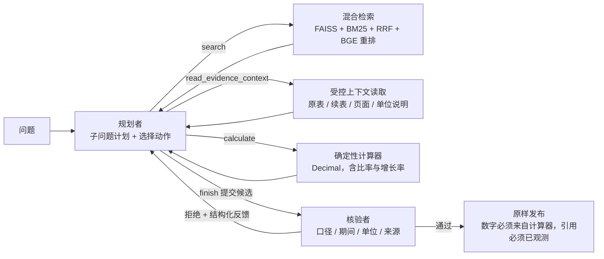

# 项目报告：财报多跳问答 Agent 的架构评估

更新：2026-09-26。本页汇总全部结论，每个数字都链接到对应的详细文档。

## 一句话

在 10 家公司 2025 年半年报上，我们用冻结的评测集、配对置信区间和可重放的审计，逐项量化了 Agent 技术的收益。主要发现有四点：

- **检索和 Agent 循环是主要收益来源。**
- **在干净证据上，多角色（规划 + 核验）没有可测量的收益。**
- **盲注入证据错误后，原版核验角色也没有净收益。**
- **按故障诊断改进核验角色后，多角色在列错位故障下首次显著优于单模型 Agent。**

这项改进目前只在 Dev 上得到验证，还需要 Test 确认。

## 系统

| 组成 | 说明 |
| --- | --- |
| 语料 | 10 家公司半年报，1,750 页；用 Docling 解析为 9,322 条可追溯证据块（正文、表格 Markdown、表格键值）。[语料](system/DOCLING_CORPUS_RESULTS.md) |
| 检索 | 本地 HTTP 服务；向量 + BM25 → RRF 融合 → 交叉编码器重排。30 题开发集 Hit@5 为 29/30，MRR@10 为 .81，nDCG@10 为 .71；Dev 68 条事实 Hit@5 为 .91。重排序使事实级 Hit@5 提高 7.4 pp [1.5, 14.7]。[检索](system/M2_V2_RESULTS.md)、[排序指标](experiments/RETRIEVAL_METRICS_V1.md) |
| Agent | LangGraph 实现四个角色：规划、执行、核验、综合。另有预算控制与预留、结构化重规划、JSON schema 校验加一次格式修复，以及已核验答案的原样发布。[设计](system/AGENT_M31_DESIGN.md) |
| 模型 | deepseek-v4.1-flash，经 OpenCode Go 的 OpenAI 兼容接口调用。[选型](system/TEACHER_V2_DEEPSEEK.md) |
| 审计 | 每条轨迹都会检查：模型决策与工具调用逐一对应、计算可以重放、上下文读取可以从索引重放、故障变换可以逐字重放。 |

## 评测集 benchmark_v1

- **答案来源**：答案不由模型或人工撰写，而是从 **298 条经过源文件核验的事实**（事实台账，[FACT_LEDGER_V1](benchmark/FACT_LEDGER_V1.md)）出发，由程序用 Decimal 计算。
- **题型**：共 6 种，分别是单跳陷阱、两公司运算、条件桥接、比率与增长、三跳及以上、无法回答。[设计](benchmark/BENCHMARK_DESIGN.md)
- **规模**：Dev 50 题，Test 100 题。
- **冻结与保护**：评测集已冻结；Test 只有在配置登记后，并加上 `--final` 参数，才能运行。[冻结说明](benchmark/BENCHMARK_V1_FROZEN.md)
- **质量检查**：用两个模型评判题目歧义，并由人工抽查 20 道 Test 题。[质检](benchmark/BENCHMARK_V1_QUALITY.md)

## 结论（按可信度分档）

### A. 已确立（事先登记，配对 bootstrap 95% 区间，审计通过）

**逐级对照**（Dev，各跑 3 次，[S6 基线](experiments/BENCHMARK_V1_S6_BASELINES.md)）：

| 配置 | 准确率 | 相对上一级 |
| --- | ---: | --- |
| B0 闭卷 | 18.7% | — |
| B1 固定 RAG（每家公司检索一次，模型调用一次） | 61.3% | **+42.7 [+28.0, +56.7]** |
| B2 单模型 Agent（多步检索 + 上下文 + 计算器） | 92.7% | **+31.3 [+18.7, +44.7]**，主要来自桥接题和三跳题 |
| B3 四角色 Agent | 93.3% | +0.7 [−5.3, +6.7]，但模型调用多 23%、输出 token 约为 2 倍 |

**格式修复**（JSON schema 校验加一次带反馈的修复）：B2 从 92.7% 提高到 98.7%，**+6.0 [+2.7, +10.0]**，JSON 格式报错全部消除。B3 从 93.3% 提高到 96.7%，不显著。[格式修复](experiments/FORMAT_REPAIR_V1.md)

**在干净证据上，核验角色无事可做**：它看到的 266 个候选答案全部正确，没有拦下过任何错误，反而误拦了 17 次。

**盲故障注入**（44 道可回答的 Dev 题，每题分别注入三类故障，不给任何提示，[结果](experiments/FAULT_INJECTION_V1_RESULTS.md)）：

| 故障 | 无故障 → 故障后的准确率变化（B2 / B3） | 结论 |
| --- | --- | --- |
| F1 单位标错 | −4.9 / −3.9，不显著 | Agent 会用报告级单位声明核对 |
| F2 本期、上期列错位 | **−37.1 / −25.8** | 最难：数字、表格结构和期间标签看起来都合理 |
| F3 冲突的摘要表（×1.07） | **−21.2 / −16.7** | |

原版核验角色没有净收益：纠正 6 题，却把 7 个正确答案变成了拒答。F3 下，它发现摘要表与报表矛盾后会反复拒绝，直到预算耗尽。

### B. 初步结果（Dev 上显著，但 v2 是看过这批 Dev 故障后设计的）

**核验角色 v2**：在提示词中加入来源优先级、期间列核对、单一来源交叉核对和不重复拒绝四条规则。[设计](experiments/VERIFIER_V2_PLAN.md) · [结果](experiments/VERIFIER_V2_RESULTS.md)

| 故障 | B2 单模型 | B3 原版核验 | B3 核验 v2 |
| --- | ---: | ---: | ---: |
| F2 准确率 / 被误导率 | 61.4% / 29.5% | 70.5% / 27.3% | **81.8% / 9.1%** |
| F3 准确率 / 拒答率 | 77.3% / 6.8% | 79.5% / 13.6% | **90.9% / 4.5%** |
| 无故障 Dev | 98.7% | 96.7% | 96.0% |

- **判定**：事先登记的三条成功标准全部满足。
- **核验 v2 相对原版**：纠正从 6 题增加到 15 题，损害从 7 题降到 2 题。
- **相对单模型**：F2 准确率高 **+20.5 [+4.5, +36.4]**。这是多角色第一次测到显著收益。
- **代价**：无故障时，模型调用多 16%，耗时多 41%。

**规划者 v2**：修复核验 v2 引入的规划超限报错。[设计](experiments/PLANNER_V2_PLAN.md) · [结果](experiments/PLANNER_V2_RESULTS.md)

- **报错**：全部 282 次运行中，规划结构报错为 **0**，B3v2 为 4。
- **无故障 Dev 准确率**：**98.0%**。相对 B3v2 高 +2.0 pp [−1.3, +5.3]，满足非劣标准；相对 B2 + 修复为 −0.7 pp [−4.0, +2.0]，两者不可区分。
- **故障条件**：与 B3v2 相近；相对 B2，F2 高 +20.5 pp，F3 高 +18.2 pp，区间都不跨 0。
- **剩余问题**：2 次报错来自模型把整个决策嵌进 `action` 字段，格式修复也没能救回。这个问题早于规划者 v2 就存在，本轮不修。

**上下文压缩 compact_v1**（无损压缩历史）：[设计](experiments/CONTEXT_V1_PLAN.md) · [结果](experiments/CONTEXT_V1_RESULTS.md)

- **token**：每次调用的输入 token 减少 42–45%，但调用次数多了 3–9%，按题计算只减少 37–44%。
- **准确率**：无故障 Dev 为 99.3%，相对 B3v2p 为 +1.3 pp [−1.3, +4.0]。
- **判定：未通过**。有两项没满足：无故障 Dev 的节省为 37.2%，低于 40% 门槛；F2 不退步的区间下界为 −13.6 pp，低于 −10 pp（只跑 1 轮，区间宽）。
- **处理**：不采纳为默认配置，只作为描述性结果报告。

最终候选配置为 **B3v2p**（B3 + 修复 + 核验 v2 + 规划者 v2），与 B2 + 修复一起进入 Test 验证。

## 局限

- **设计偏差**：B 档结论在同一批 Dev 题和同一份注入计划上完成了设计和评估，需要 Test 做无偏确认。
- **数据范围**：
  - 评测集规模小：Dev 50 题，只有一家模型提供方；
  - 故障是人为构造的，不代表真实解析错误的分布；
  - 与单模型的故障对比是跨轮进行的。
- **记忆污染**：闭卷基线能给出部分精确到小数的正确答案，说明模型可能见过这些公开财报。因此准确率要和「各跳是否都有引用」一起看，B2 和 B3 的各跳引用覆盖率都在 99% 以上。
- **成本与耗时**：单题 2–5 分钟。服务层已经实现多用户、SSE 和公平调度（见 [Agent 服务](system/SERVICE.md)），但真实负载下的瓶颈仍是只有一个推理槽的检索服务和模型额度。

## 下一步

完整事项（harness 加固、上下文管理、服务化与多用户、多轮对话、记忆、Test 验证）见[路线图](ROADMAP.md)。主线上最近的三步是：

1. **Test 验证**：登记 B2 + 修复和最终的 B3 配置，在 Test 上各跑一次无故障运行。条件允许的话，再为 Test 建立注入计划，做一次故障验证。
2. **（可选）换一个模型**：用另一家的模型复现核心对比。

## 在哪里看更多

- 所有文档：[docs 索引](README.md)
- 单题演示：`PYTHONPATH=src .venv/bin/python scripts/demo.py --replay docs/examples/f2_column_swap_caught`
- 复现命令：[复现指南](system/REPRODUCE.md)
- 历史阶段与失败记录：[实施进度](IMPLEMENTATION_STATUS.md)、[归档](archive/README.md)
