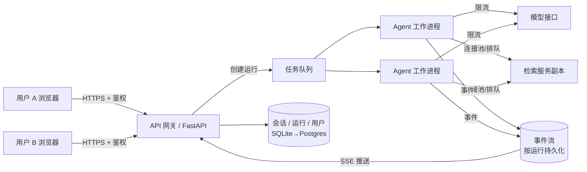
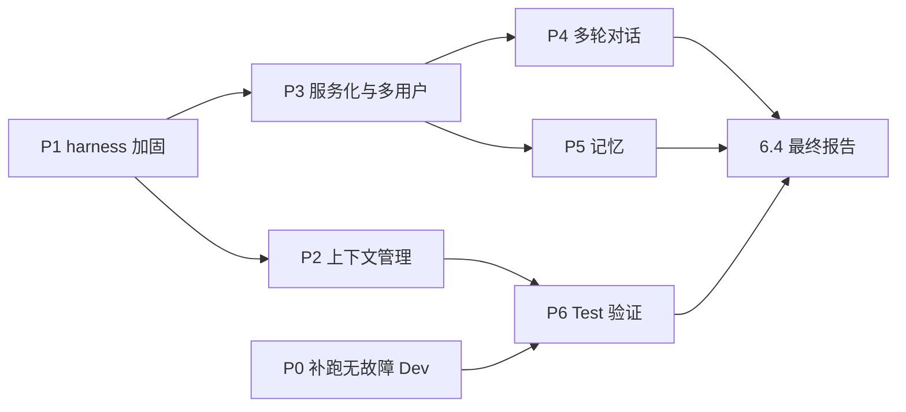

# 路线图

2026-09-26 制定。目标：把项目从「经过量化验证的 Agent 研究」扩展为「可以对外服务的多用户 Agent 系统」，同时保持「每项技术都有证据」这一原则。

**图例**：🆓 不消耗模型额度 · 💰 需要模型额度（估算以 DeepSeek Go 套餐为准） · ⏳ 进行中 · ✅ 完成

**总原则**：
- 研究类改动：先登记设计，再运行评估，最后更新[项目报告](REPORT.md)。
- 工程类改动：需要有测试或压测数据作为验收依据。

---

## P0 收尾当前实验

| # | 事项 | 验收 | 额度 |
| --- | --- | --- | --- |
| 0.1 | 补跑规划者 v2 的无故障 Dev 3 次 | 按 [PLANNER_V2_PLAN](experiments/PLANNER_V2_PLAN.md) 判定：规划结构报错为 0，且相对 B3v2 不退步 | 💰 约 1.5 小时 |

## P1 Harness 加固（先做，后面所有实验都依赖它）

P1 全部实现，见 [运行 harness](system/HARNESS.md)。金丝雀的首次真实运行要等额度恢复；CI 要等推送到 GitHub 后才会首次运行。

| # | 事项 | 验收 | 额度 |
| --- | --- | --- | --- |
| 1.1 ✅ | **快速止损**：遇到额度或计费类错误（429 额度超限、402）时，整批运行立即停止，运行标记为 `INCOMPLETE`，不再逐题失败 | 注入一个模拟的 429 额度错误后，驱动脚本在 1 题之内停止；测试覆盖 | 🆓 |
| 1.2 ✅ | **逐题续跑 + 错误分类**：`--resume` 只补跑缺失的题和基础设施失败的题；评分时区分「基础设施失败」和「Agent 答错」，补跑规则事先登记 | 中断后续跑，结果与一次跑完一致；评分报告分别列出两类失败 | 🆓 |
| 1.3 ✅ | **录制—重放**：录下模型回复和检索返回，改动图逻辑后用录制内容重放，做零成本回归测试 | 现有示例轨迹能 100% 重放；故意改坏预算逻辑时测试能发现 | 🆓 |
| 1.4 ✅ | **提供方漂移监测**：清单记录 git commit、工作区是否有未提交改动、接口地址和响应中的模型标识；每批开跑前先跑 5 道固定的「金丝雀」题并与基准比对 | 金丝雀结果偏差超过阈值时拒绝开跑 | 💰 每批约 5 题 |
| 1.5 ✅ | **运行登记表 + 成本预检**：从所有运行的清单、审计和评分自动生成总表（状态、指标、花费）；开跑前估算本批 token 消耗 | 能一条命令生成总表；预计消耗超过设定上限时拒绝启动 | 🆓 |
| 1.6 ✅ | **检索资源调度**：用跨进程锁或队列管理单推理槽的检索服务 | 两个进程并行运行时 503 错误为 0 | 🆓 |
| 1.7 ✅ | **CI**：GitHub Actions 自动跑单元测试、示例轨迹重放和录制重放回归测试 | PR 上自动运行并通过 | 🆓 |

## P2 上下文管理（研究项，结果进入 benchmark_v1 的最终配置）

2.1、2.2 已完成：无损策略 S4 在离线测算中减少 50%（B3）和 58%（B2）的输入 token，没有隐藏任何被引用的证据。见 [设计与事先登记](experiments/CONTEXT_V1_PLAN.md)。2.3 的效率门槛在运行前改为 ≥ 40%，理由见该文档。

| # | 事项 | 验收 | 额度 |
| --- | --- | --- | --- |
| 2.1 ✅ | **离线测算**：在已有轨迹上模拟各种压缩策略，测算提示词能缩小多少 | 给出各策略的 token 缩减比例，选定方案并登记 | 🆓 |
| 2.2 ✅ | **实现**：工具返回的全文放进证据库，提示词中保留紧凑索引；规划中引用的证据块和最新一次返回保留全文，旧返回只保留已提取的值；同一证据块去重。通过配置切换 | 单元测试覆盖；录制重放回归测试通过 | 🆓 |
| 2.3 | **正式评估**：三类故障各 1 轮，加无故障 Dev 3 次 | 事先登记：输入 token 下降 ≥ 50%，且无故障 Dev 和故障条件下都不劣于现有配置（区间下界 ≥ −5 个百分点） | 💰 约 3 小时 |

## P3 服务化与多用户（工程项）

目标：把 Agent 包装成支持多用户并发、实时推送每一步的服务。架构如下：

| # | 事项 | 设计要点 | 验收 | 额度 |
| --- | --- | --- | --- | --- |
| 3.1 | **服务 API** | 提供以下接口： • `POST /sessions`：创建会话 • `POST /sessions/{id}/questions`：提交问题，返回运行 ID • `GET /runs/{id}`：查询运行状态与结果 • `DELETE /runs/{id}`：取消运行 • `GET /runs/{id}/trajectory`：获取完整轨迹 | OpenAPI 文档；接口测试 | 🆓 |
| 3.2 | **SSE 流式推送** | `GET /runs/{id}/events` 按顺序推送规划、工具、核验和最终答案等事件。每个事件带递增 ID 并持久化，断线后可凭 `Last-Event-ID` 续传。定时发送心跳；运行结束时推送终止事件 | 断线重连后事件不丢、不重复；测试覆盖 | 🆓 |
| 3.3 | **异步执行** | 提交接口立即返回，Agent 在工作进程池中运行。支持取消，取消会传到模型调用和工具调用。设置单题超时，已有的预算控制继续生效 | 取消后 2 秒内停止并推送终止事件 | 🆓 |
| 3.4 | **多用户隔离** | 用 API key 或 JWT 鉴权。会话、轨迹和会话记忆按用户隔离；公开报告的文档结构记忆可以跨用户共享（见 P5）。越权访问返回 404 | 越权访问测试全部被拒 | 🆓 |
| 3.5 | **限流与配额** | 按用户限制请求速率、并发运行数和每日 token 配额；全局限制模型并发数。排队满时返回 429 并带 `Retry-After`；多个用户之间公平调度 | 压测中单个用户无法挤占其他用户 | 🆓 |
| 3.6 | **共享资源** | 检索服务可以扩展为多副本或批量推理；模型调用使用带退避的连接池；背压逐级传递 | 压测中没有错误级联 | 🆓 |
| 3.7 | **持久化** | 会话、运行和事件存入 SQLite，接口层抽象后可以换成 Postgres；轨迹存为文件或对象存储 | 服务重启后历史运行可查询 | 🆓 |
| 3.8 | **可观测性** | 结构化日志带上运行 ID 和用户 ID。指标包括各角色延迟、token 消耗、队列深度和 SSE 连接数；用 OpenTelemetry 为每个节点和工具调用建 span | 能从一次运行 ID 追到全部日志和 span | 🆓 |
| 3.9 | **最小前端** | 聊天界面 + 实时轨迹面板（SSE）+ 引用证据的原文查看 | 演示视频或截图 | 💰 演示少量 |
| 3.10 | **压测** | 用录制—重放的模拟模型（按真实延迟分布回放），模拟 N 个并发用户 | 报告吞吐量、p95 延迟、SSE 稳定性和公平性指标 | 🆓 |
| 3.11 | **安全** | 增加 F4 提示注入故障：在证据里藏指令，测 Agent 是否照做；输入校验；跨租户隔离测试 | F4 结果进入报告；隔离测试全部通过 | 💰 F4 约 1 小时 |

## P4 多轮对话（研究项，新评测集 benchmark_v2）

| # | 事项 | 验收 | 额度 |
| --- | --- | --- | --- |
| 4.1 | **生成多轮题**：从事实台账出发，把桥接题和三跳题拆成多轮追问，包含「它」「同期」「另一家」等指代和省略；每轮答案由程序计算 | 生成器测试；歧义检查 | 🆓（歧义检查少量 💰） |
| 4.2 | **质检与冻结**：沿用 benchmark_v1 的流程，同样划分 Dev 和 Test | 冻结清单 | 💰 少量 |
| 4.3 | **对话状态管理**：在 3.1 的会话中保存对话历史；实现三种策略，即每轮独立回答、带完整历史、带压缩记忆 | 单元测试 | 🆓 |
| 4.4 | **评估**：比较三种策略的逐轮准确率、指代错误率和 token 随轮数的增长 | 事先登记，给出配对区间 | 💰 约 3–4 小时 |

## P5 跨题 / 跨会话记忆（研究项）

| # | 事项 | 验收 | 额度 |
| --- | --- | --- | --- |
| 5.1 | **文档结构记忆**：按报告记录报表位置、单位说明等结构性知识。只有核验通过的答案所用的证据才会写入；记忆只作为线索，引用前必须重新读到原文 | 单元测试；审计能确认每条引用都来自当次观测 | 🆓 |
| 5.2 | **多用户下的记忆边界**：文档记忆基于公开报告，可以跨用户共享；对话记忆按用户隔离；共享记忆的写入需要经过核验，防止被污染 | 隔离测试；污染注入测试 | 🆓 |
| 5.3 | **评估**：用两种题目顺序各跑一次，审计错误是否通过记忆传播；比较检索次数、成本和准确率 | 事先登记；准确率不下降且成本下降 | 💰 约 3 小时 |

## P6 最终验证与交付

| # | 事项 | 验收 | 额度 |
| --- | --- | --- | --- |
| 6.1 | **登记 benchmark_v1 的最终配置**：B2 + 修复，以及 B3 最终版（含 P2 的上下文管理） | 登记表提交 | 🆓 |
| 6.2 | **Test 运行**：无故障各 1 次；条件允许时，为 Test 另建一份注入计划做故障验证 | 按登记规则一次跑完，结果写进报告 | 💰 约 2–4 小时 |
| 6.3 | （可选）**换一个模型**：用另一家模型复现核心对比 | 同上 | 💰 |
| 6.4 | **更新报告与首页**：加入服务架构、压测结果、多轮对话结果和完整局限 | REPORT 与 README 更新 | 🆓 |

---

## 顺序与依赖

- **P1 最先做**：止损和续跑决定额度是否会被浪费，录制—重放是 P3 压测和所有回归测试的基础。
- **P3 基本不消耗额度**：可以在等待额度恢复时推进。
- **P6 的 Test 只评估 benchmark_v1 的主线结论**：它不必等 P4 和 P5，因为 P4、P5 使用自己的新评测集，结论互不影响。
- **额度粗估**：P0 + P2 + P6 约 7–9 小时；P4 + P5 + 3.11 约 8–9 小时。按本周实际消耗粗略推算，每周额度大约够跑 12–15 小时的实验，全部完成需要 2–3 个额度周期。这个数字未经核实，以 OpenCode 控制台为准。
