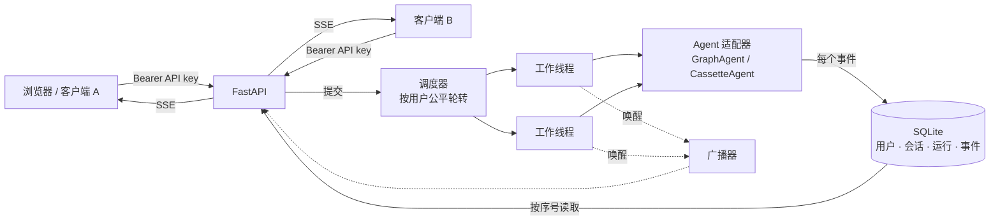

# Agent 服务：多用户、异步执行与 SSE 流式推送

2026-09-26，对应路线图 P3。代码在 `src/finmhqa/service/`，测试在 `tests/test_service.py`，压测脚本是 `scripts/loadtest.py`。

## 架构

| 模块 | 职责 |
| --- | --- |
| `store.py` | 持久化：用户（只保存 API key 的哈希）、会话、运行、按运行编号的事件流。运行一旦进入终止状态，就不会再被改写 |
| `scheduler.py` | 工作线程池、按用户的公平队列、取消与超时、事件扇出 |
| `agents.py` | 两个 Agent 适配器：`GraphAgent` 运行真实的 LangGraph Agent；`CassetteAgent` 按录制时的耗时重放真实轨迹（不调用模型），用于测试、演示和压测 |
| `limits.py` | 按用户做准入控制：提问频率、未完成运行数、每日 token 配额 |
| `app.py` | HTTP API、鉴权、所有权检查、SSE 推送 |
| `observability.py` | Prometheus 文本格式的指标、JSON 结构化日志 |
| `static/index.html` | 演示前端：步骤时间线、证据高亮、历史提问、示例问题 |

## API

所有接口都需要 `Authorization: Bearer <key>`，只有 `/` 和 `/healthz` 例外。

| 方法与路径 | 作用 |
| --- | --- |
| `POST /sessions` | 创建会话 |
| `GET /sessions/{id}` | 查看会话及其中的所有运行 |
| `POST /sessions/{id}/questions` | 提交问题。返回 202、`Location` 和 `run_id`，立即返回，不等待运行结束 |
| `GET /runs` | 当前用户最近的运行（历史侧栏用），最新的在前 |
| `GET /runs/{id}` | 查看运行状态、答案和 token 消耗 |
| `DELETE /runs/{id}` | 取消运行 |
| `GET /runs/{id}/events?detail=summary\|full` | SSE 实时事件流 |
| `GET /runs/{id}/trajectory` | 完整轨迹，包含证据全文 |
| `GET /metrics` | Prometheus 指标，只对管理员开放 |
| `GET /healthz` | 健康检查 |

## SSE 协议

- **事件格式**：每个事件都带 `id`（该运行内递增的序号）、`event`（事件类型）和 `data`（JSON）。
  - 事件类型：`status`（排队或开始运行）、`node`、`teacher_decision`（规划或核验的决策）、`tool_request`、`tool_response`、`verification`、`final`、`end`。
  - 所有事件先持久化再推送，所以断线期间产生的事件都不会丢。
- **断线续传**：重连时带上 `Last-Event-ID`（或查询参数 `after`），服务端从下一条事件接着推送，不丢也不重复。服务端会发送 `retry: 2000`，建议客户端 2 秒后重连。
- **心跳与结束**：没有新事件时，每隔一段时间（默认 15 秒）发送一条 `: ping` 注释行，防止代理切断空闲连接。`end` 事件带上终止状态（完成、失败、已取消、超时）后，服务端关闭流。
- **详略两种模式**：`detail=summary` 下，工具返回只推送证据块的标签（ID、类型、页码、表名），不推送正文；`full` 下推送完整内容。
- **代理设置**：响应头带 `X-Accel-Buffering: no`，让 Nginx 等反向代理不缓冲事件流。
- **浏览器端**：浏览器的 `EventSource` 不能设置 `Authorization` 头，所以前端用 `fetch()` 读取流、自己解析 SSE，避免把 API key 放进 URL（URL 会出现在日志和浏览历史里）。

## 多用户

- **鉴权**：API key 由 `scripts/service_admin.py` 生成，只显示一次，数据库里只保存 SHA-256 哈希。
- **隔离**：会话和运行都有所属用户。访问别人的资源一律返回 404，而不是 403，这样不会暴露资源是否存在。`/metrics` 只对管理员开放。
- **准入控制**：超限一律返回 429 并带 `Retry-After`：
  - 每分钟提问次数；
  - 排队和运行中的运行数；
  - 每日 token 配额，按 UTC 自然日统计。
- **全局背压**：全局队列满时返回 503 并带 `Retry-After`。
- **公平调度**：
  - 按用户轮转取任务，每个用户同时执行的运行数不超过自己的 `max_concurrent`，一个用户的突发请求占不满所有工作线程。
  - 调度器另外保留一个 FIFO 模式，只用作压测的对照组。
- **取消与超时**：
  - 取消或超时后，运行立即进入终止状态并推送 `end` 事件，测试中确认 2 秒内结束。
  - 工作线程会在 Agent 的下一个事件处停下。已经发出的模型调用会先跑完，结果随后丢弃；这是协作式取消的固有限制。
  - 终止状态不会被迟到的结果覆盖。
- **重启**：服务启动时，把上次进程留下的「排队中」和「运行中」的运行标记为失败，并补发 `end` 事件，不会悄悄重跑。
- **输入校验**：问题长度必须在 4 到 500 字之间，并去掉控制字符。

## 前端

前端面向演示场景，采用专业金融风格，跟随系统的明暗模式，手机宽度下改为单列布局。

- **进度条**：显示当前阶段（排队 → 规划 → 执行工具 → 核验 → 完成），以及用时、模型调用次数、工具调用次数、核验拒绝次数和输入 token 数。
- **步骤时间线**：每一步规划是一张卡片，显示动作、理由、可以展开的子问题计划、耗时和 token 数。检索、读取上下文和计算器的结果放在对应的卡片里。核验拒绝用红色卡片显示问题代码和修改建议，紧接着的修正步骤会标上「根据核验反馈修正」。
- **证据高亮**：点击答案的引用，显示对应证据块。Markdown 表格会渲染成真正的表格，首列固定不随横向滚动，答案计算中实际用到的数值会高亮并自动滚动到可见位置。
- **检索细节**：每次检索下方默认展开「召回细节」，显示四列：
  - 向量召回（bge-m3，余弦相似度）前 30 名；
  - BM25 召回（jieba 分词）前 30 名；
  - RRF 融合（k=60），括号内是该条在向量和 BM25 两路中的名次；
  - 重排序后的结果：前 5 名就是最终交给 Agent 的证据，并标出它们来自哪一路召回、重排前的候选名次。

  每列默认显示前 8 名，可以展开其余。最终入选的证据块用金色标记；鼠标悬停时，会在各列同时高亮同一个证据块。顶部一行汇总两路各召回多少、重合多少，以及最终 5 条的来源构成。
  - **数据来源**：检索服务新增可选参数 `trace`。真实 Agent 检索时带上它，召回细节作为单独的 `retrieval_trace` 事件推送给前端，同时从交给 Agent 的工具返回中去掉。测试确认，带和不带 `trace` 时的检索结果逐项相同。
  - **演示轨迹库**：`scripts/build_cassette_library.py` 为 Dev 的全部 50 道题各挑一条真实录制轨迹，取自核验 v2 三次无故障运行中答对、没有报错的那一条，放在 `data/service/cassettes/`（不纳入 git）。之后对库里共 161 次检索全部补算召回细节，每次重算出的最终结果都与录制时一致。`GET /examples` 从库里按题型各挑一道，优先挑核验角色拒绝过、之后修正的题，便于演示。
  - **录制轨迹**：录制轨迹原本没有召回细节，由 `scripts/backfill_retrieval_traces.py` 用相同参数离线重算后补上。只有重算出的最终结果与录制时完全一致才会写入，页面上会注明这是重算结果。
- **历史提问**：左侧列出当前用户最近的提问。点击任一条，会从头重放它的完整事件流。
- **示例问题**：预置单跳、桥接、比率、无法回答四类问题，点击即可填入。

## 可观测性

- **指标**：已提交、已完成（按状态）、被拒绝（按原因）的运行数；运行耗时和各角色模型调用耗时的直方图；队列深度、执行中的运行数、SSE 连接数。
- **日志**：JSON 格式，每条都带 `run_id` 和 `user_id`，可以按一次运行串起全部日志。
- **与 OpenTelemetry 的关系**：指标和日志的命名与 OpenTelemetry 的 span 属性对应，接入 OTel SDK 时只需要替换 `observability.py` 里的两个类。目前没有引入 OTel 依赖。

## 验证

**功能测试**：共 10 项，不调用模型。覆盖完整流程、鉴权与跨用户隔离（6 类越权访问全部返回 404）、断线续传不丢不重、取消在 2 秒内结束且不会被覆盖、超时与心跳、输入校验、3 种用户限额、全局队列满时返回 503、公平调度、重启后的处理、API key 以哈希保存。这些测试连续运行 5 次都通过。

**浏览器端到端测试**：用重放的真实轨迹启动服务，在前端页面提问。规划、检索、核验拒绝、修正、最终答案都实时显示，点击引用可以看到证据原文。

**压测**（[报告](../evidence/service/loadtest_2026-09-26.json)）：用 48 条真实的 Dev 录制轨迹，按录制耗时的 1/20 重放，每次运行约 8 秒；4 个工作线程。

| 场景 | 结果 |
| --- | --- |
| 8 个用户各提 3 个问题，同时进行 | 24 次运行全部完成；**事件丢失或重复 0 次**；其中 8 次运行在中途断线后续传，事件序号全部连续；提交到第一个事件 p95 为 45 ms；吞吐量 25 次/分钟，约为 4 个工作线程理论上限的 84% |
| 公平性：重度用户一次提交 16 个，0.5 秒后 4 个轻度用户各提交 2 个 | 轻度用户的排队等待中位数，FIFO 为 47.5 秒，**公平调度为 10.6 秒**；p95 从 59.4 秒降到 26.7 秒。代价是重度用户的排队中位数从 8.7 秒升到 39.0 秒，这正是设计目标 |

压测衡量的是服务层本身，不包括模型和检索的吞吐。真实运行时，瓶颈在检索服务只有一个推理槽，以及模型提供方的限流和额度。

## 已知局限与扩展路径

- **单机**：SQLite 加进程内工作线程，只适合单机部署。`Store` 的接口很小，扩展路径是：
  - 数据库换成 Postgres；
  - 队列和事件扇出换成 Redis Streams 或消息队列；
  - API 节点和 worker 进程分开部署，各自水平扩展。
- **检索服务**：检索服务只有一个推理槽，是真实负载下的首要瓶颈。可以部署多个副本，或者改为批量推理。
- **取消粒度**：取消以「下一个事件」为粒度，已经发出的模型调用无法中途打断。
- **鉴权方式**：鉴权用的是 API key，没有实现 JWT 或 OAuth；前端是最小实现。
- **提示注入**：F4 提示注入故障的评估需要模型额度，尚未进行。
